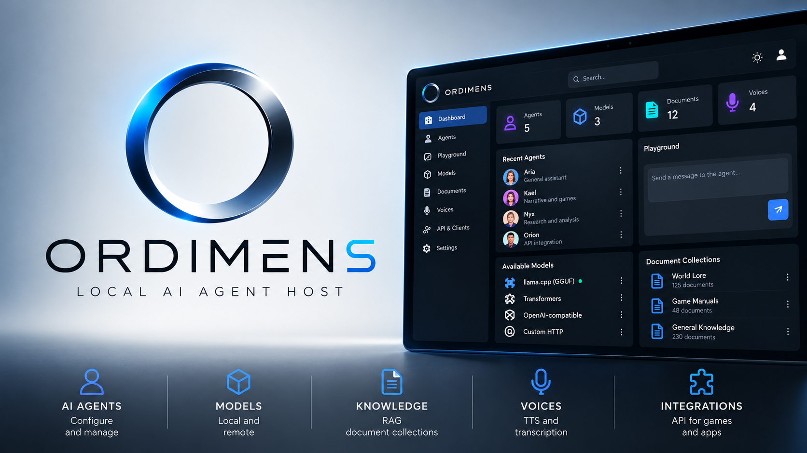

# ORDIMENS

### Create, Manage & Connect AI Agents — Linux and Windows

ORDIMENS is a locally hosted platform for creating, configuring, testing and connecting AI agents to language models, knowledge bases, speech systems, games and external software.

Manage your agents through a browser on the host computer, or from another device on your local network when LAN access is configured. Use compatible local models or connect to remote endpoints.

**Current release:** 0.5.99 RC1  
**Platforms:** Linux x86-64 and Windows x64  
**Distribution:** Compiled application for Patreon members

This is the public information repository. ORDIMENS is proprietary and closed-source. Application binaries, source code and private build tools are not hosted here.

## Character Studio

Create an agent around a personality, with optional AI assistance.

- Choose a robot avatar, an emoticon or upload your own image.
- Select traits and describe your character, role or assistant.
- Organise your description into editable instructions manually.
- Alternatively, choose a configured LLM to propose a name, introduction and system prompt.
- Review the proposal before accepting and saving it.
- Configure the finished agent's models and capabilities separately.

The model writing the profile can be different from the model running the agent. Profile generation does not automatically replace voice, vision or listening assignments.

Avatars identify agents visually. Instructions guide responses. Game actions, tools, persistent world state and autonomous routines require support from the connected application.

## Agents and Playground

- Multiple agents with individual instructions and model assignments.
- Generation settings, response limits and context budgets.
- Conversation history and knowledge connections.
- Integrated Playground for testing conversations.
- Character Pack imports for compatible projects.

Updates to existing Character Pack agents preserve their configured voice and other resource assignments while applying the selected LLM.

## Model connections

| Backend | Purpose |
| --- | --- |
| llama.cpp | Compatible local GGUF models |
| Transformers | Supported architectures and model directories |
| OpenAI-compatible APIs | Compatible local or remote services |
| Custom HTTP endpoints | Configurable external services |

Compatibility depends on model architecture, format, runtime and available hardware. Some vision-enabled GGUF models require an additional mmproj file.

## Knowledge bases and RAG

Create document collections, upload documents or enter text, and connect reusable knowledge to individual agents.

Use cases include documentation assistants, specialised characters and other knowledge-driven applications.

## Voice and listening

Supported configurations include Qwen3-TTS, Chatterbox, Kokoro, Whisper, Faster-Whisper and Qwen ASR.

Guided runtime preparation is available for supported engines. Runtime recipes and compatibility vary by platform. Model weights, voices and third-party licences must be checked separately.

## Games and external applications

Connect software through the API and connection codes with configurable permissions.

Select specific agents using the searchable, collapsible selector, or grant access to all agents within the supported scope.

Compatible applications can provide Character Packs containing predefined agents and associated knowledge.

Possible uses include NPCs, interactive characters, specialised assistants and applications requiring a shared agent host.

## Download

[Download ORDIMENS on Patreon](https://www.patreon.com/Zetalvx/posts/ordimens-173839463)

### Linux x86-64

Download:

ORDIMENS_0.5.99_rc1_Linux_x86_64.zip

Extract the archive, open a terminal in the extracted directory and run:

    bash INSTALLA_ORDIMENS.sh

After installation:

    /usr/bin/ordimens start
    /usr/bin/ordimens status
    /usr/bin/ordimens stop
    /usr/bin/ordimens logs

### Windows x64

Download:

ORDIMENS_0_5_99_RC1_Windows_x64_Setup.exe

Run the Setup EXE and follow the installer. The same installer handles first installation and updates.

Start ORDIMENS from the desktop or Start menu shortcut.

### Updating

Stop the running server before updating with an external installer. Closing the browser tab does not stop the server.

Keep the existing installation location and preserve application data and optional model runtimes.

Linux also supports the in-app ZIP update workflow with the compiled installation and update package.

English and Italian quick-start instructions accompany the release. Further help is available inside the application.

Compare your downloaded file with its entry in the supplied SHA256SUMS file. Checksums verify file integrity, not publisher identity.

## Requirements and release status

- Linux x86-64 or Windows x64.
- A modern browser.
- Suitable RAM and VRAM for local models, or access to a compatible remote provider.
- Separately configured model weights, optional inference runtimes and GPU drivers.
- Internet access where needed for downloads, runtime preparation or remote services.

ORDIMENS is a release candidate. Compatibility and performance vary across models, runtimes and hardware.

A locally hosted application can still use remote providers. Data sent to a remote endpoint follows that provider's operation and terms.

## Demonstration projects

The Lantern Chronicles is a separate experimental RPG exploring AI-powered NPCs and knowledge-driven conversations through an external agent host.

The game and its Character Packs are distributed separately and are not included in ORDIMENS.

Dedicated Unity, Unreal Engine and Godot plugins are separate development work and are not included in this release. API-based integrations can be implemented independently.

## Licensing

The ORDIMENS core is proprietary and closed-source. This public repository does not grant an open-source licence to the application.

The terms supplied with the release apply. Third-party components, runtimes and model weights retain their own licences.

## Feedback and contact

When reporting a problem, include your operating system, application version, selected model and runtime, and a relevant log excerpt.

Remove credentials and connection codes before sharing logs.

**Contact:** zetalvx_contact@proton.me

**ZetaLvX — AI Automation Lab**

[YouTube](https://www.youtube.com/@zetalvx) · [Website](https://zetalvx.com)
